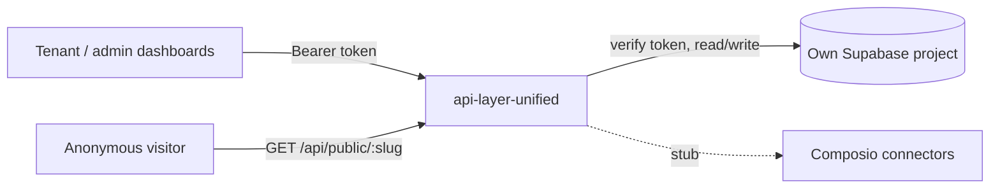

# api-layer-unified

Stand-alone Node/Express back end meant to be "the one API" for a multi-business platform: tenants, installable apps, third-party connectors and a public directory listing.

## What it is

A small multi-tenant API. A business (tenant) logs in with Supabase Auth, installs first-party "apps" (only booking has feature code) and third-party "connectors", and edits its public directory listing. Platform admins manage the app and connector catalogs and can edit any listing. It has its own generic schema and no code dependency on other CultureReset repos; some helper patterns were copied from them (see `lib/extracted/README.md`).

## How it works

- `server.js`: Express with CORS and a rate limit keyed on the hashed Authorization header. `mount()` wraps each route file so a broken one logs instead of crashing boot. Endpoints `/api/health` and `/api/whoami`.
- Tenant routes (login required): `routes/apps.js`, `routes/apps/booking.js` (resources, time-slots, prices, bookings), `routes/connectors.js`, `routes/content.js`, `routes/profile.js`.
- Admin routes: `routes/admin-tenants.js`, `admin-apps-catalog.js`, `admin-connectors-catalog.js`, `admin-directory.js`.
- Public: `routes/public.js`, `GET /api/public/:slug` (the only route that takes an identifier from the URL).
- Auth: `middleware/tenantAuth.js` and `middleware/adminAuth.js` verify a Supabase Auth bearer token, then look the user up in `tenant_members` or `platform_admins`. The tenant is never taken from the URL, query or body.
- Database: `migrations/001_init.sql` creates tenants, members, admins, app and connector catalogs and installs, booking tables, content sections and tenant profiles. `db.js` builds the Supabase client.
- Install state is a status on a persistent row (`installed` / `uninstalled`; connectors also `pending` / `connected` / `error` / `disconnected`), not delete-on-uninstall.
- `lib/extracted/*.js` (14 helper modules such as credential vault, webhook signature, CSV parser) are not wired into `server.js`.
- The Composio connect flow is a stub: `connect` only records intent as pending.

## Run it

```bash
# 1. New Supabase project; apply migrations/001_init.sql
cp .env.example .env     # fill in
npm install
npm start                # listens on PORT (README default 4000)
npm run check            # scripts/check-no-hardwiring.mjs
```

Env var names: `SUPABASE_URL`, `SUPABASE_SERVICE_KEY`, `PORT`. An admin needs a row in `platform_admins` and a tenant needs rows in `tenants` and `tenant_members`, added by hand. Not run as part of this review.

## Status

Stalled: a coherent, runnable skeleton from August 2026 (single commit) with only booking implemented; the live platform API is `gcr-api-clean`, not this.

## Where it fits



## Related repos

- `gcr-api-clean`: does the same job (owner API plus entity data) for the live platform with a different schema (`entity` / `entity_owners`).
- Patterns borrowed from `gcr-api-clean`, `cybercheck-api-database`, `cybercheck-cloud`, `cybercheck-orchestrator` and `Admin-dashboard-main`; no code dependency on them.
